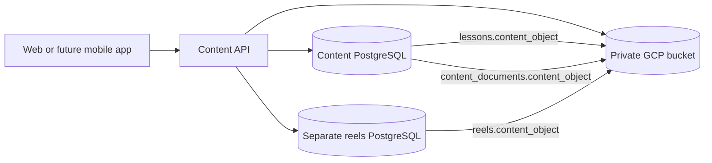
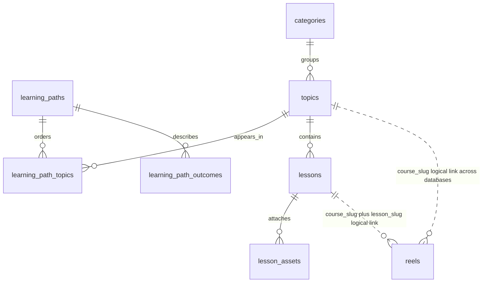

# Engineering paths, database, and bucket

Open [the visual storage map](content-storage-map.html) for a diagram, the priority order, table details, and publishing steps. This describes the repository implementation; the live environment still needs the migrations and rollout described in [backend-content.md](backend-content.md).

## Path priority

| Priority | Path | Stable slug |
| --- | --- | --- |
| 1 | Gen AI Engineering | `gen-ai` |
| 2 | AI / ML Engineering | `ai-ml` |
| 3 | Cloud Platform Engineering | `cloud` |
| 4 | Backend Engineering | `backend` |
| 5 | Full-stack Foundations | `full-stack` |
| 6 | Forward Deployed Engineering | `forward-deployed` |

Forward Deployed Engineering is sixth because it was requested but was not assigned a position in the five-item priority list. All six paths reference existing lesson-bearing topics. This organizes the available material; it does not claim a complete new curriculum for each role.

The backend seeds missing paths from `services/content-service/src/main/resources/engineering-paths.json` after topic seeding. Home and Paths fetch `/api/content/paths`, ordered by `priority`, then slug. After first insertion, database edits remain authoritative. Restarting does not overwrite edited paths.

## Storage relationships





| Database / owner | Table | Stored fields and purpose |
| --- | --- | --- |
| Content / content-service | `learning_paths` | `slug` PK, name, subtitle, description, icon, tone, `priority` (lower first) |
| Content / content-service | `learning_path_topics` | `path_slug` FK, `topic_slug` FK, `position`; unique topic and position per path |
| Content / content-service | `learning_path_outcomes` | `path_slug` FK, `position`, outcome |
| Content / content-service | `categories` | id, slug, name, description, icon, sort_order |
| Content / content-service | `topics` | id, category_id FK, slug, name, summary, level, sort_order; a topic is a course in the current application |
| Content / content-service | `lessons` | id, topic_id FK, slug, title (heading), step_number, stage, exclusive, updated_at, content_object, content_md (local fallback only) |
| Content / content-service | `lesson_assets` | UUID, lesson_id FK, object_name, filename, content_type, expected_size, generation, ready, created_at |
| Content / content-service | `content_documents` | name PK (`practice`), content_object, body (local fallback only); practice object is a JSON question array |
| `sarvaikam_reels` / content-service reel API | `reels` | slug PK, course_slug, lesson_slug, heading, content_object, content (local fallback), source_name, source_url, published, updated_at |
| Auth database / auth-service | `users`, `role_policies`, `access_audit` | Account, access, and audit data; unrelated to content-body uploads |
| Progress database / progress-service | `lesson_progress`, `lesson_bookmarks` | User/lesson ids, topic_slug, completion/bookmark timestamps |

Auth and progress use the main PostgreSQL database in the default deployment; their service connection settings can differ. Reels explicitly uses its own database. Reel course/lesson references are logical rather than PostgreSQL foreign keys because they cross databases. The API resolves the current course name and step and checks current exclusive access.

## Bucket layout

```text
gs://<GCP_CONTENT_BUCKET>/               Private; currently configured name: cotent_bucket
├── lesson-bodies/
│   └── <uuid>.md                       Lesson Markdown
├── reel-bodies/
│   └── <uuid>.md                       Reel text, one point per line
├── practice-bodies/
│   └── <uuid>.md                       JSON question array (current suffix is .md)
└── lessons/
    └── <lesson-id>/
        └── <asset-uuid>                PDF / video / ZIP; filename stays in DB
```

These are object-name prefixes. Body objects get new UUID names on each save. Course, step, heading, and source are database fields rather than folder names. A database object reference stores `lesson-bodies/<uuid>.md`, **without** `gs://bucket/`. Readers use the configured bucket plus this relative name. Manually uploaded nested names also work when the database references their exact relative object names.

Uploading a file alone does not publish it. Inserting metadata alone does not upload the body. Both sides must exist. Keep old objects until you have checked references and backups; overwriting a referenced body bypasses the application's revision behavior.

## Add content directly

### Through the application

Use Content studio for lessons/resources and Reel studio for reels. These handle validation, permissions, object uploads, and database links. The direct workflow below is useful for reviewed bulk imports and database-console editing. It bypasses application validation, so check slugs, access flags, source attribution, ordering, and the actual object before publishing.

### Through the bucket and database console

1. Write a reviewed UTF-8 `lesson.md` and include source references in the Markdown. Lesson provenance is currently part of the body, while reels have separate source fields.
2. In Google Cloud Console, open **Cloud Storage → Buckets → your configured bucket → lesson-bodies**. Upload it under a fresh name, such as `<new-uuid>.md`. Confirm the upload, then copy the relative object name.
3. Open the PostgreSQL query editor connected to the **content** database. Choose an existing topic/course, insert the lesson metadata below, and use the exact object name. A non-exclusive lesson becomes publicly readable when committed; there is no lesson draft/published field yet.
4. For a reel, upload text under `reel-bodies/`, then connect to **sarvaikam_reels**, insert its metadata with `published=false`, review, and explicitly publish it.
5. Verify the lesson through `/api/content/topics/<course>/lessons/<lesson>` and the reel through the admin feed before publication. Reload the Home/Paths page after path changes.

The operator uploading objects and editing PostgreSQL needs appropriate existing access to those systems. Application users continue reading through the backend; the bucket stays private.

### Upload with PowerShell

```powershell
# Uses your existing gcloud login; replace the bucket if your environment differs.
$contentBucket = 'cotent_bucket'
$revisionId = [guid]::NewGuid().ToString()
$lessonObject = "lesson-bodies/$revisionId.md"
gcloud storage cp ./lesson.md "gs://$contentBucket/$lessonObject" --content-type='text/markdown; charset=utf-8' --if-generation-match=0
if ($LASTEXITCODE -ne 0) { throw 'Upload failed; do not insert the database reference.' }
$lessonObject  # Paste this exact relative name into SQL below.
```

The generation precondition prevents replacing an existing object. See Google's [upload command reference](https://docs.cloud.google.com/sdk/gcloud/reference/storage/cp) and [request preconditions](https://docs.cloud.google.com/storage/docs/request-preconditions).

### Insert a lesson into an existing course

Connect to the content database. Replace the object name below with the successfully uploaded relative name. This example requires the seeded `llms` course. It inserts a new lesson, and intentionally fails on a duplicate slug rather than overwriting an existing lesson.

```sql
BEGIN;
INSERT INTO lessons (topic_id, slug, title, step_number, stage, exclusive, content_md, content_object)
SELECT id, 'retrieval-practice', 'Build a retrieval practice workflow',
       100, 'INTERMEDIATE', false, NULL,
       'lesson-bodies/REPLACE-WITH-UPLOADED-UUID.md'
FROM topics WHERE slug = 'llms'
RETURNING id, slug, content_object;
-- Confirm exactly one returned row and the uploaded object name before COMMIT.
COMMIT;
```

Choose a step number within the intended learning stage. The reader orders by stage, then step, then id; the database does not enforce unique step numbers. For an update, upload a fresh object and update `content_object`, set `content_md=NULL`, and set `updated_at=now()` for the selected lesson. Do not change a published slug unless you intend a different URL.

### Insert a reel into the separate database

Upload `reel.txt` with the same command using a fresh `reel-bodies/<uuid>.md` object name. Connect to `sarvaikam_reels`, substitute the body object and actual source, and keep the first insert as a draft. The lesson above must already exist in the content database.

```sql
INSERT INTO reels
  (slug, course_slug, lesson_slug, heading, content_object,
   source_name, source_url, published)
VALUES
  ('retrieval-practice-intro', 'llms', 'retrieval-practice',
   'Retrieve context before generating an answer',
   'reel-bodies/REPLACE-WITH-UPLOADED-UUID.md',
   'REPLACE WITH ORIGINAL SOURCE TITLE', 'https://example.com/replace-with-original-source', false);

-- Review source, body, lesson access, and the admin feed first. Then publish:
UPDATE reels SET published=true, updated_at=now()
WHERE slug='retrieval-practice-intro';
```

### Add a course and place it in a path

Connect to the content database. Inspect `SELECT id, slug, name FROM categories ORDER BY sort_order, id` and choose the appropriate category. This example uses the existing LLM topic's category and adds the course at the end of the Gen AI path.

```sql
BEGIN;
INSERT INTO topics (category_id, slug, name, summary, level, sort_order)
SELECT category_id, 'gen-ai-applications', 'Gen AI Applications',
       'Reviewed application projects and evaluation exercises.', 'INTERMEDIATE', 100
FROM topics WHERE slug='llms';

INSERT INTO learning_path_topics(path_slug, topic_slug, position)
SELECT 'gen-ai', 'gen-ai-applications', COALESCE(MAX(position), 0) + 1
FROM learning_path_topics WHERE path_slug='gen-ai';
COMMIT;
```

Add lessons to the new course using its slug. Paths hide empty courses until they have lessons. If other authors are changing path membership at the same time, coordinate the position or retry on a unique-position conflict.

### Change priority directly

```sql
UPDATE learning_paths
SET priority = CASE slug
  WHEN 'gen-ai' THEN 1 WHEN 'ai-ml' THEN 2 WHEN 'cloud' THEN 3
  WHEN 'backend' THEN 4 WHEN 'full-stack' THEN 5 WHEN 'forward-deployed' THEN 6
END
WHERE slug IN ('gen-ai', 'ai-ml', 'cloud', 'full-stack', 'backend', 'forward-deployed');

SELECT slug, name, priority FROM learning_paths ORDER BY priority, slug;
```

Do not edit Flyway history tables to add content. Practice edits require preserving the complete `PracticeQuestion` JSON array shape (id, category, title, difficulty, minutes, topic, prompt, constraints, hints, criteria, outline); upload a fresh object and change `content_documents.content_object` where `name='practice'`, with `body=NULL`.
